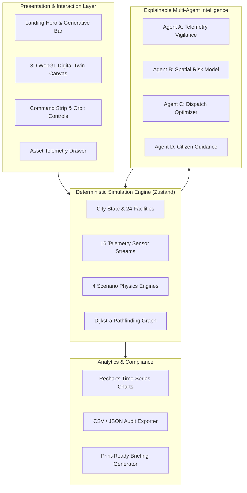

# AETHER — The Living World
### Autonomous 3D Digital Twin & Explainable Simulation Platform

<div align="center">


<p align="center">
  <strong>An interactive 3D digital twin and environmental simulation engine that couples physical municipal models with transparent, deterministic multi-agent intelligence.</strong>
</p>

[Explore Capabilities](#-core-capabilities) • [Architecture](#-system-architecture) • [Platform Pages](#-application-directory) • [Quick Start](#-quick-start)

---

</div>

## Overview

> **“See the system. Simulate the future. Shape what happens next.”**

**AETHER** is a browser-native smart city digital twin and scenario modeling platform. Built on modern WebGL and physics-based deterministic state transitions, AETHER provides operators, urban planners, and engineers with an unhindered real-time window into complex municipal interactions.

Rather than relying on opaque cloud APIs or static 2D dashboards, AETHER computes all spatial calculations, telemetry drifts, hazard propagations, and shortest-path emergency rerouting locally inside the client at 60 FPS.

---

## 🌟 Core Capabilities

```
┌─────────────────────────────────────────────────────────────────────────────┐
│                          AETHER CORE PLATFORM                               │
├──────────────────────┬──────────────────────┬───────────────────────────────┤
│   3D DIGITAL TWIN    │  SCENARIO LABORATORY │      EXPLAINABLE AI AGENTS    │
│  24 Real Facilities  │  4 Cascading Hazards │  Telemetry • Spatial Risk     │
│  16 Telemetry Beacons│  Dynamic Physics     │  Dispatch • Citizen Broadcast │
├──────────────────────┼──────────────────────┼───────────────────────────────┤
│  DIJKSTRA REROUTING  │ REAL-TIME ANALYTICS  │      AUDIT & COMPLIANCE       │
│  22-Node Road Graph  │ Multi-series Recharts│  JSON & CSV Export            │
│  Real-time Detours   │ Sensor Baseline Drift│  Print-Ready Legal Briefings  │
└──────────────────────┴──────────────────────┴───────────────────────────────┘
```

### 1. 🏙️ Immersive 3D Digital Twin Viewport
- **High-Performance Procedural Rendering:** Built with Three.js, React Three Fiber, and React Three Drei with procedural CAD geometries, edge glow shaders, and dynamic lighting.
- **24 Municipal Assets across 4 Districts:**
  - **Civic Core:** AETHER Spire, City Hall, Central Telecom Hub, Grand Transit Terminal, Central Substation Alpha, Municipal Justice Center.
  - **Waterfront Basin:** Seawall Defense, Coastal Pump Station, Harbor Logistics Dock, Ferry Terminal, Marine Biological Station, Desalination Plant.
  - **Industrial Sector:** Chemical Refinery Delta, Substation Beta, High-Voltage Switching Yard, Heavy Rail Depot, Waste Recycling Facility, Automated Distribution Center.
  - **Tech & Medical Quadrant:** Horizon Hospital, Emergency Command Center, Datacenter Cluster, Clean Tech Incubator, Medical Research Laboratory, North Substation Gamma.
- **Interactive Raycasting & Asset Drawer:** Click on any facility to view live microclimate telemetry, structural integrity, power draw, and municipal history.
- **Cinematic Orbit & Camera Presets:** Instant camera transitions between Overview, Central Spire, Waterfront Basin, Industrial Sector, and Tech/Medical Quadrant.
- **Dynamic Layer HUD:** Real-time toggles for Buildings, Sensor Beacons, Hazards, Road Infrastructure, and Emergency Routes.
- **2D Canvas Fallback:** Hardware-accelerated 2D isometric fallback renderer guaranteeing 100% functionality on legacy or non-WebGL devices.

### 2. ⚡ Autonomous Telemetry Sensor Network
- **16 Distributed Sensor Beacons:** Continuous measurement of ambient temperature, particulate air quality index (AQI), coastal water surge levels, structural micro-vibrations, and substation grid load.
- **Microclimate Equilibrium Drift:** Dynamic simulated baseline variations with realistic diurnal thermal oscillations and rapid threshold breach detection during crises.

### 3. 🧪 Scenario Laboratory (Deterministic Physics Simulation)
- **Urban Storm Surge & Coastal Flooding:** Seawall breaches above 0.85m elevation; water inundates low-lying corridors and triggers emergency pump stations.
- **Industrial Chemical Incident:** Volatile thermal combustion (>80°C), hazardous particulate dispersion (>400 AQI), structural failure, and autonomous 300m containment radii.
- **Metropolitan Extreme Heatwave:** High-pressure thermal dome (>42°C) elevating municipal grid cooling demand by 45% and activating public cooling shelters.
- **Power Grid Cascading Disruption:** Substation breaker trip cascading through commercial and industrial distribution feeders, forcing critical facilities to battery backup.
- **Fine-Grained Calibration:** Adjust disaster severity (20% to 100%), duration (30s to 120s), and target district with real-time Play, Pause, Step-Advance, and Reset.

### 4. 🤖 Explainable Multi-Agent AI Operations
AETHER rejects black-box neural hallucinations in favor of 4 specialized, mathematically auditable autonomous agents:
- **Agent A (Telemetry Vigilance):** Ingests streaming sensor signals, identifies anomalous rates of change ($\Delta T / \Delta t$), and flags statistical threshold breaches.
- **Agent B (Spatial Risk Modeling):** Calculates transparent composite spatial vulnerability indexes using the verified equation:
  $$\text{Risk Score} = 0.40 \times \text{Exposure} + 0.35 \times \text{Asset Importance} + 0.25 \times \text{Structural Vulnerability}$$
- **Agent C (Response Planning & Dispatch):** Prioritizes endangered facilities and dispatches specialized emergency units to highest-yield containment zones.
- **Agent D (Citizen Communications):** Translates raw physical telemetry into calm, clear, actionable evacuation guidance and public safety advisories.

### 5. 🛣️ Dijkstra Dynamic Rerouting Engine
- **Connected Municipal Road Network:** 22 intersections and 26 road segments modeled as an active graph.
- **Live Impedance Recalculation:** When storm surge waters inundate roadways or chemical barriers seal streets, edge weights update dynamically to $\infty$.
- **Autonomous Traffic Avoidance:** Emergency dispatch vehicles and citizen traffic continuously compute optimal paths using true Dijkstra shortest-path traversal.

### 6. 📊 Real-Time Analytics & Time-Series Workspace
- **Dynamic Recharts Telemetry:** Visual time-series progression for multi-sensor temperatures, surge elevations, and electrical load over continuous simulation time.
- **Asset Health Matrix:** Functional breakdown of critical infrastructure by operational status (Nominal, Warning, Critical, Offline).
- **Delta Analysis:** Real-time discrepancy reporting comparing active conditions against historical equilibrium baselines.

### 7. 📑 Incident Reporting & Verification
- **Post-Incident Assessment Documents:** Automated compliance reports generated directly from deterministic simulation telemetry.
- **Multi-Format Data Export:**
  - **CSV Dataset:** Complete tabular telemetry records for external spreadsheet analysis.
  - **JSON Audit:** Structured machine-readable event log for downstream municipal APIs.
  - **Print-Ready Briefing:** Formatted formal document ready for immediate printing or PDF generation.

### 8. 🎛️ Architectural Themes & Accessibility
- **Dual Visual Calibration:**
  - **Dark Mode:** Deep cyberpunk command console optimized for low-light operations centers.
  - **Light Mode:** High-contrast architectural CAD instrument optimized for brightly lit planning environments.
- **Accessibility & Performance Controls:** Support for reduced motion, toggleable 3D spatial labels, adjustable graphics fidelity presets, and touch-optimized responsive layouts for phones, tablets, and large displays.

---

## 🏗️ System Architecture



---

## 🧭 Application Directory

| View / Page | Path / Route | Description |
| :--- | :--- | :--- |
| **Landing Page** | `/` | Cinematic entry page with interactive 3D hero city, natural language scenario bar, and quick capability previews. |
| **Digital Twin** | `Digital Twin` | Full-screen interactive 3D command center featuring all 24 facilities, live sensor beacons, camera presets, and downpage asset directory. |
| **Scenario Lab** | `Scenario Lab` | Interactive disaster simulation laboratory with severity sliders, district targets, timeline scrubbers, and live hazard rendering. |
| **AI Operations** | `AI Operations` | Real-time cockpit displaying explainable mathematical evaluations and autonomous recommendations from all 4 AI agents. |
| **Analytics** | `Analytics` | Comprehensive telemetry graphing workstation featuring dynamic Recharts time-series and district comparative metrics. |
| **Incident Reports** | `Incident Reports` | Formal post-incident audit documentation center with instant CSV, JSON, and print-ready document exports. |
| **Settings** | `Settings` | System-wide configuration for theme toggling (Dark/Light), graphics quality presets, cursor modes, and accessibility preferences. |

---

## 💻 Tech Stack

- **Framework:** [React 19](https://react.dev/) + [TypeScript](https://www.typescriptlang.org/) (Strict Mode)
- **Bundler & Build Tool:** [Vite 8](https://vitejs.dev/)
- **Styling:** [Tailwind CSS v4](https://tailwindcss.com/)
- **3D Graphics Engine:** [Three.js](https://threejs.org/) via [@react-three/fiber](https://r3f.docs.pmnd.rs/) and [@react-three/drei](https://github.com/pmndrs/drei)
- **State Management:** [Zustand](https://github.com/pmndrs/zustand)
- **Charting & Data Viz:** [Recharts](https://recharts.org/)
- **Icons:** [Lucide React](https://lucide.dev/)
- **Test Suite:** [Vitest](https://vitest.dev/) + [@testing-library/react](https://testing-library.com/) (15/15 passing tests)

---

## ⚡ Quick Start

### 1. Clone & Install Dependencies
```bash
git clone https://github.com/MohanSriJ/AETHER.git
cd AETHER
npm install
```

### 2. Run Test Suite
```bash
npm test
```
*Executes all 15 unit, simulation, routing, and UI component tests.*

### 3. Start Development Server
```bash
npm run dev
```
*Opens the interactive development server at `http://localhost:5173/`.*

### 4. Build for Production
```bash
npm run build
```
*Compiles TypeScript and generates the optimized production bundle in `dist/`.*

### 5. Preview Production Build
```bash
npm run preview
```
*Serves the optimized build locally at `http://localhost:4173/`.*

---

## 🌐 Deployment

The application is fully client-side and can be hosted instantly on any static edge CDN.

### Deploying to Vercel
This repository includes a pre-configured `vercel.json` for single-page routing:
1. Import your GitHub repository into **[Vercel](https://vercel.com/)**.
2. Framework Preset: **Vite** (Build: `npm run build`, Output: `dist`).
3. Click **Deploy**.

### Deploying to Netlify
1. Import your GitHub repository into **[Netlify](https://netlify.com/)**.
2. Build Command: `npm run build`, Publish Directory: `dist`.
3. Click **Deploy Site**.

---

<div align="center">

**AETHER — The Living World**  
*Built with precision for the future of urban resilience and spatial intelligence.*

</div>
